# karanVerse InterviewOS AI

**Version 1.0.0**

Personal interview and career intelligence coach. Upload a resume, compare it to a job description, sit a mock interview, and get an explainable report with skill gaps and a learning roadmap.

This is a coaching product, not a chatbot wrapper and not a hiring predictor. Scores are practice signals. They are not a probability of being hired.

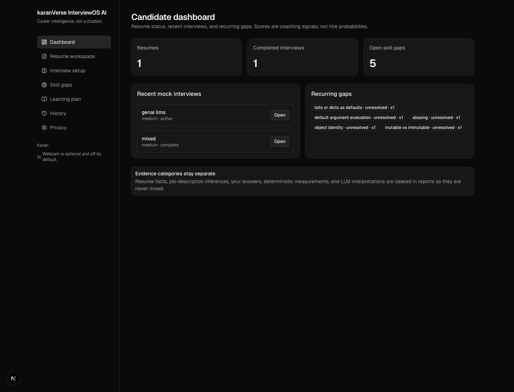

## What this project is for

KaranVerse InterviewOS AI helps a candidate prepare for data science and ML interviews with evidence they can inspect:

- See what the resume actually documents, and what is only a keyword.
- See what a target job asks for, and where the resume is strong, partial, or missing.
- Practice in a virtual interview or a structured text room instead of an open-ended chat.
- Read a report that separates answers, deterministic scores, and optional LLM commentary.
- Turn gaps into a learning plan with verified links or search suggestions, never invented citations.

Typical local loop: resume workspace → interview setup → virtual interview or text room → evaluation report → skill gaps → learning roadmap.

## How GenAI is implemented

Generation is optional and never the source of truth.

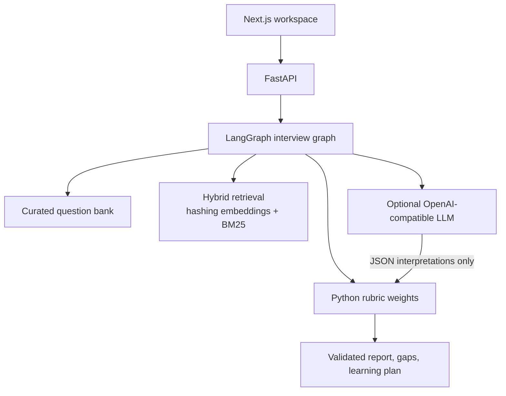

**Orchestration.** A LangGraph state machine plans the session, asks one question at a time, retrieves evidence, evaluates the answer, decides a bounded follow-up, then builds gaps, a learning plan, and a report.

**Where the model is used.** If `LLM_API_KEY` and `LLM_BASE_URL` are set, the backend can call any OpenAI-compatible `/chat/completions` API (OpenAI, Azure, Groq, OpenRouter, Ollama, vLLM). The model returns structured JSON interpretations. It does not compute the final weighted score. On OpenRouter the client stays on free models only (`:free` or `openrouter/free`). `LLM_MODEL=random` picks one model from `LLM_MODELS` per call. In a virtual interview the same LLM writes the next spoken turn: it reacts to the last answer, then asks the next question in its own words. Speech-to-text is not billed to the LLM provider.

**Where the model is not trusted.** Python owns rubric weights, follow-up limits, alignment math, and report validation. Resume facts, job-requirement inferences, candidate answers, deterministic measurements, and LLM interpretations stay labeled separately.

**Fail-closed path.** With no key, or after a provider error, the interview still runs from the question bank. Evaluations are labeled `deterministic_concept_coverage`. The API never pretends an LLM call succeeded.

**Retrieval.** Hybrid RAG (lexical BM25 + hashing embeddings, fused with RRF) attaches short evidence snippets to the evaluation context. It is an assistant to scoring, not a free-form chatbot memory.

**Learning resources.** Only verified URLs are linked. Everything else is a search suggestion.

Credentials stay on the Python backend. The browser never receives an API key.

## Product tour

Screenshots below are from a local demo session: a pasted resume, an ML Engineer job description, a completed mixed interview, and an open GenAI interview room.

### Candidate dashboard

Counts for resumes, completed interviews, and open gaps. Recent sessions stay one click away.


### Resume workspace

Upload PDF/DOCX or paste text. Extracted skills keep a source section and an evidence kind: keyword presence versus demonstrated evidence. Paste a job description to extract requirements and compare alignment.

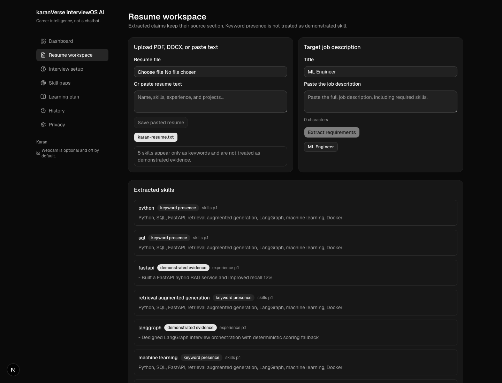

### Interview setup

Pick role, mode (including GenAI and LLMs), difficulty, duration, optional resume and job context, spoken answers, and optional webcam. A **virtual interview** is the spoken live session: the interviewer reads aloud, you answer out loud, and the camera can stay on for presence. Speech is transcribed on this device for free. Audio stays in the browser. Webcam frames stay local unless the candidate consents to server-side visual analysis. Camera or microphone denial still allows a typed interview. The session does not start until microphone consent is given.

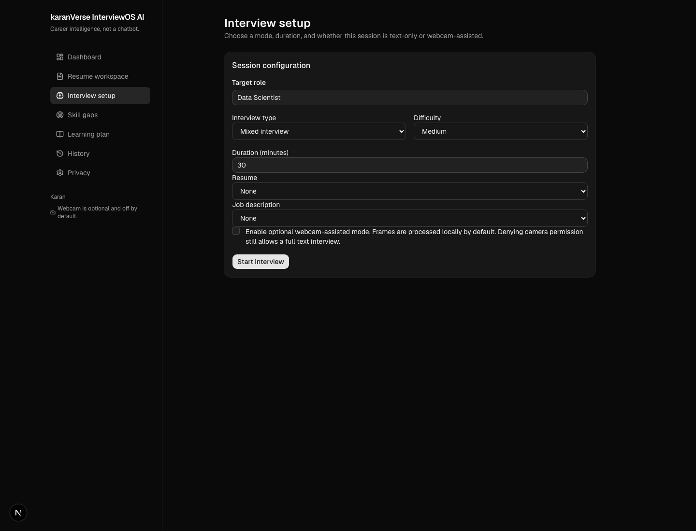

### Virtual interview

A virtual interview is a live conversation, not a form. There is no Start speaking or I am done button. After you consent, Neerja (neural Indian English) greets you, asks the first question, then listens. A 5-second silence after you finish a thought submits the transcript. Short exits such as "I don't know" or "can we skip" still advance: the coach acknowledges what you said and moves to the next question.

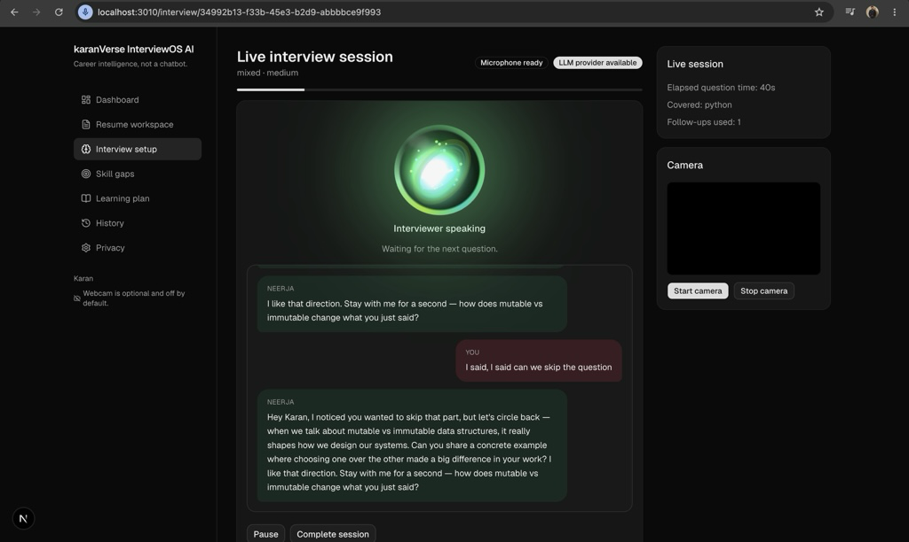

The screenshot above is a live mixed / medium session:

- **4D voice orb.** Silver while idle or waiting. Green only while the interviewer is talking. Red only while you are talking. Thinking, loading, or listening without speech stays silver.
- **Conversation thread.** Neerja on the left (green-tinted). You on the right (rose). The coach reacts to the last answer, then asks the next question in spoken words. Here the candidate asked to skip; Neerja accepted that and circled back to mutable vs immutable data structures.
- **On-device transcription.** Chrome `voiceIsolation` plus echo / noise suppression opens the mic. Clips are transcribed locally (Whisper-tiny.en). Scoring uses the transcript, not the raw audio. Paid cloud speech-to-text is not used.
- **Optional camera.** Off until you start it. Denying the camera does not stop the spoken interview.
- **Provider badge.** `LLM provider available` means spoken bridges and evaluations can use the configured free OpenRouter pool. Without a key the session still runs on the question bank.

Text-only rooms still exist: one question at a time, topic, learning objective, and a timer. Help and reference answers stay hidden until requested.

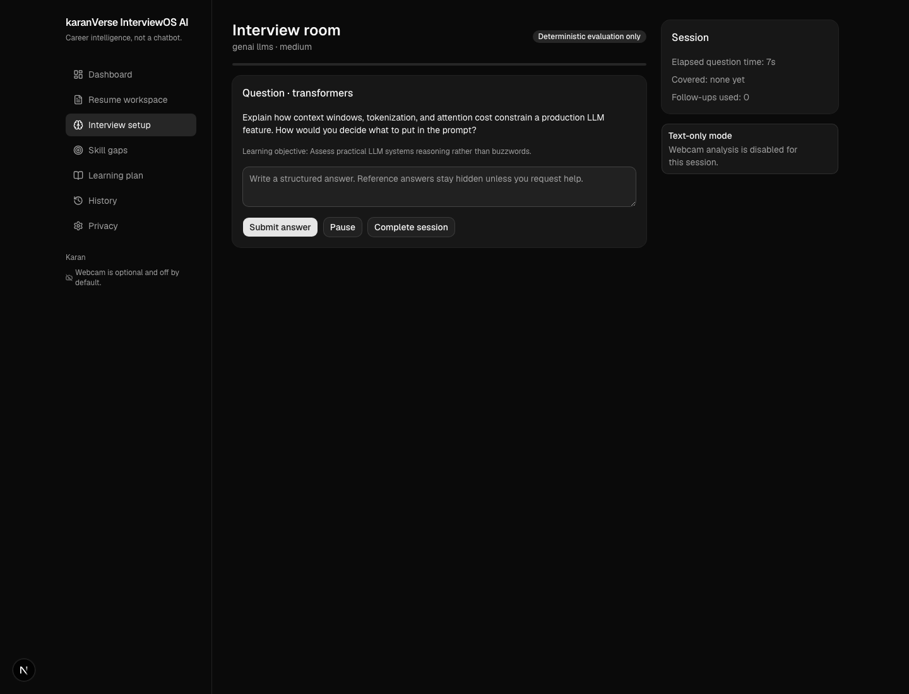

### Evaluation report

Technical score, provenance, coverage, and per-question feedback. Visual observations, if any, stay on a separate scale. Emotion, honesty, and personality are never inferred.

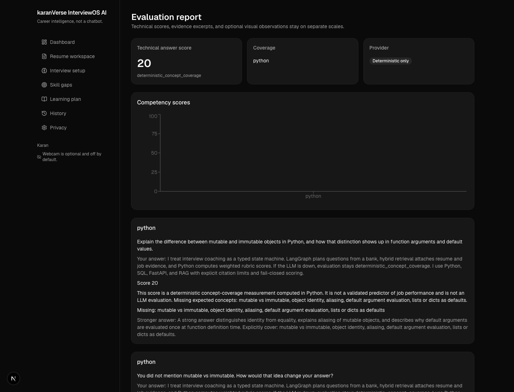

### Skill gaps

Gaps are stored after a completed session and ranked by job relevance, severity, and recurrence.

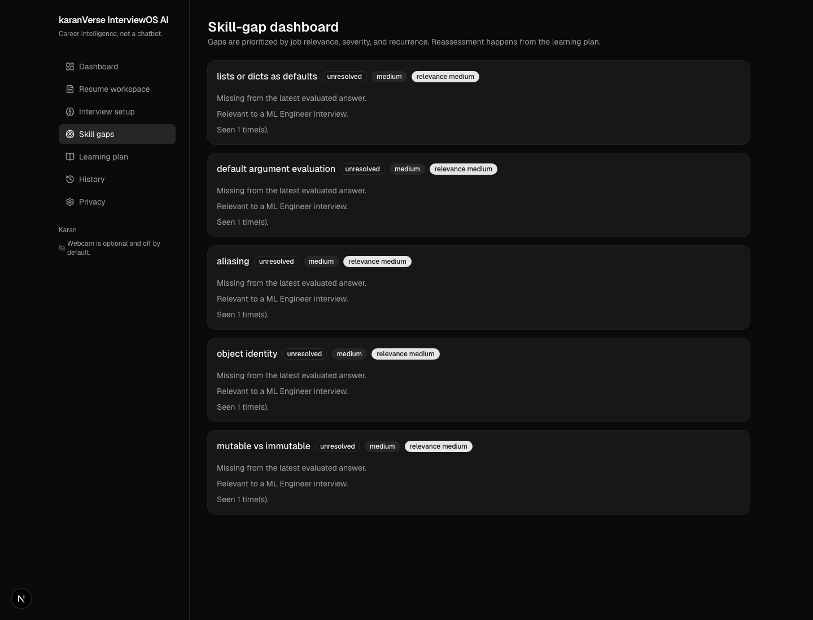

### Learning roadmap

Each gap becomes practice: why it matters, a search suggestion or verified reading link, a practice question, and a reassessment rule.

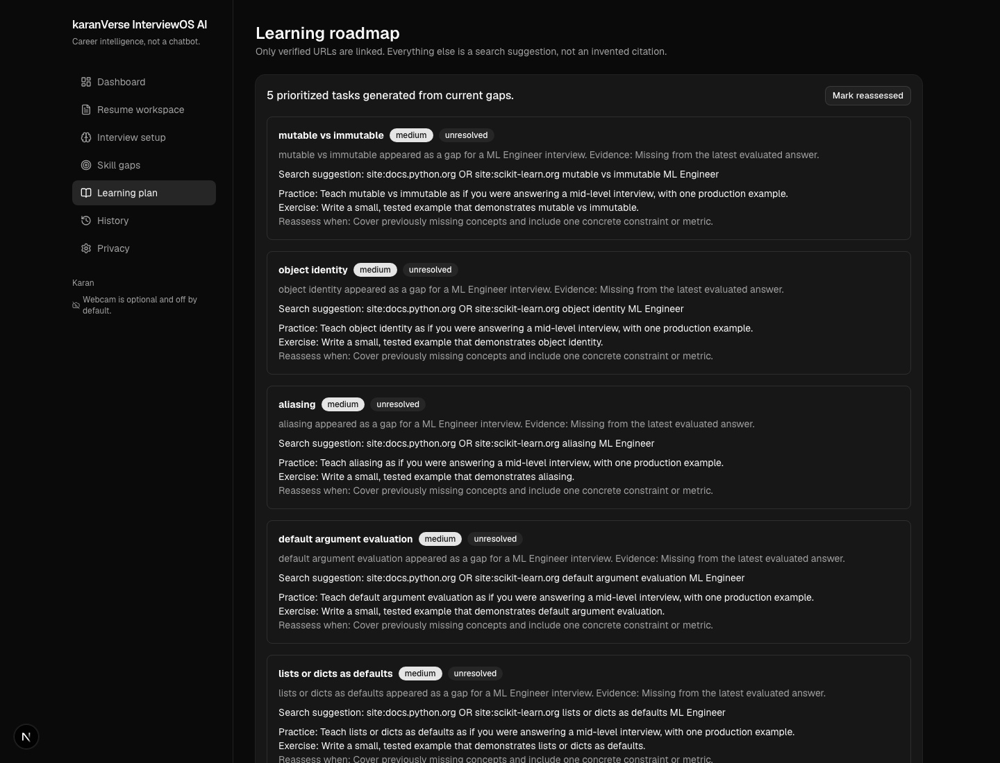

### Session history

Completed and in-progress sessions, with a score trend only across comparable mode, difficulty, and rubric version.

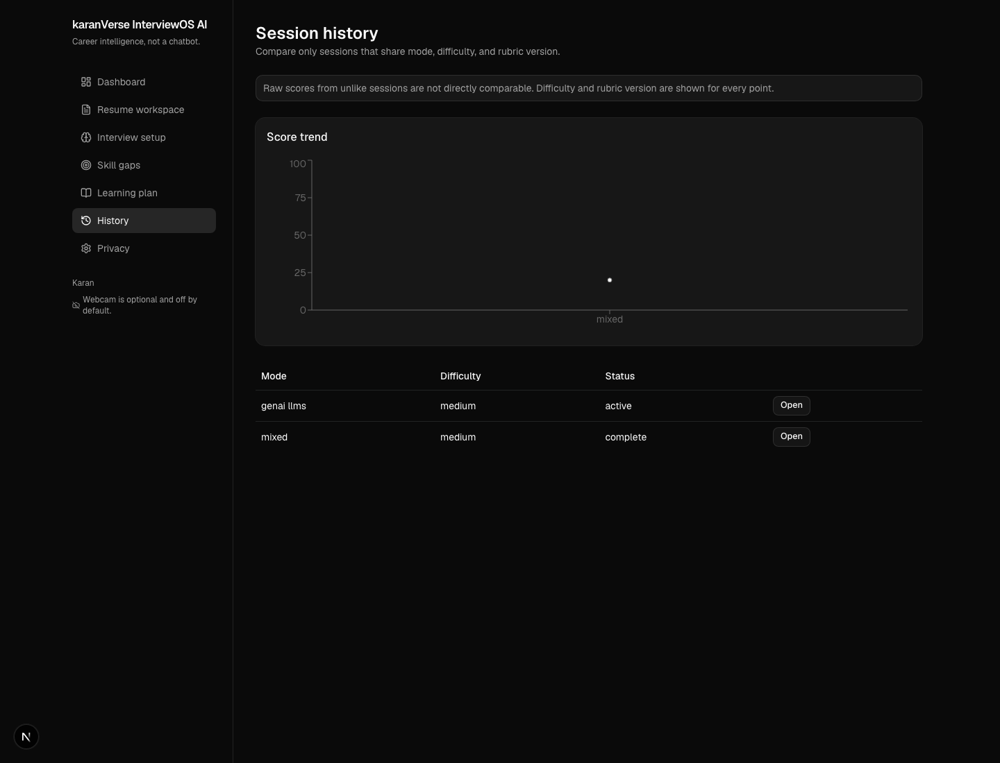

### Privacy

Retention, camera consent, optional media storage, and account data deletion. Raw video is not stored by default.

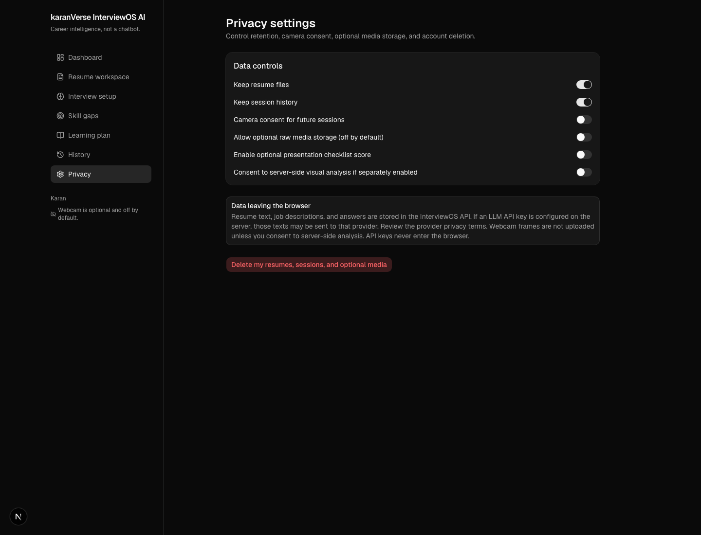

## Architecture

| Layer | Stack |
| --- | --- |
| Frontend | Next.js App Router, TypeScript, Tailwind, shadcn/ui, TanStack Query |
| Backend | FastAPI, Pydantic v2, SQLAlchemy 2, Alembic |
| Interview engine | LangGraph, curated question bank, Python rubric scoring |
| Optional generation | Generic OpenAI-compatible Chat Completions client; OpenRouter free-only pool with random pick |
| Spoken coach | LLM spoken bridge after each answer; skip / "I don't know" advances without a follow-up |
| Speech | On-device Whisper STT, Chrome voice isolation, Neerja neural TTS; 4D voice orb |
| Retrieval | Hybrid BM25 + hashing embeddings |
| Vision | Optional OpenCV face-box geometry and recording-quality flags |
| Local data | SQLite by default; PostgreSQL + Redis + Celery in Docker Compose |

```
frontend/   App Router UI
backend/    API, graph, scoring, parsers
infra/      Compose notes
docs/       Screenshots for this README
scripts/    Local helpers
```

## Local setup

```bash
cp .env.example .env
cd backend
python3.12 -m venv .venv
source .venv/bin/activate
pip install -e ".[dev]"
uvicorn app.main:app --reload --port 8000
```

```bash
cd frontend
npm install
npm run dev
```

Open [http://localhost:3000](http://localhost:3000). Local mode skips sign-in (`AUTH_REQUIRED=false`) and uses a single workspace user.

Optional generation:

```bash
# backend .env — OpenRouter free models only. Speech-to-text stays on-device.
LLM_API_KEY=sk-or-v1-...
LLM_MODEL=random
LLM_MODELS=openrouter/free,google/gemma-4-26b-a4b-it:free,nvidia/nemotron-3.5-lightning:free
LLM_BASE_URL=https://openrouter.ai/api/v1
LLM_STT_MODEL=
TTS_VOICE=en-IN-NeerjaNeural
```

Docker Compose starts Next.js, FastAPI, PostgreSQL, Redis, and Celery:

```bash
cp .env.example .env
docker compose up --build
```

## Testing

```bash
cd backend && pytest -q
cd ../frontend && node --test tests/visual.test.ts
```

## Limitations

- Alignment and interview scores are coaching signals, not hire probabilities.
- A skill name on a resume is keyword presence until a project or metric demonstrates it.
- Visual metrics are geometric and quality flags only. They are not attention, emotion, or deception measures.
- Learning links are either verified URLs or search suggestions. The product does not invent papers or courses.
- Virtual interview speech-to-text is on-device and English-first. Chrome or Safari is required for the live mic path.
- OpenRouter audio transcription is not used. There is no free cloud STT on that API, and paid audio credits are not required.

## License

MIT. See [LICENSE](LICENSE).
