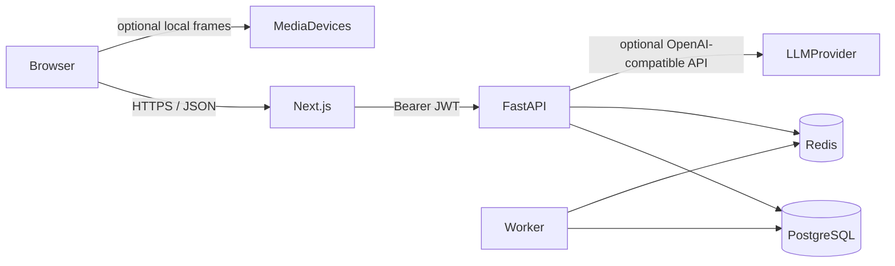

# Infrastructure

Local development uses Docker Compose:

- `frontend` — Next.js App Router
- `backend` — FastAPI
- `postgres` — PostgreSQL 16 with pgvector
- `redis` — Celery broker
- `worker` — Celery worker
- `scheduler` — Celery beat for media retention

## Architecture

Visual analysis is an optional subsystem. The default path keeps frames in the browser and stores only aggregated numeric features when the candidate consents.
